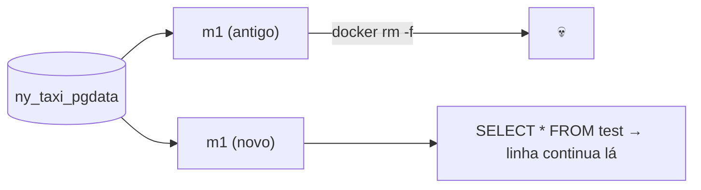

# Zoomcamp M1 — Docker, Postgres, Terraform, GCP

Repo: [de-zoomcamp-2026/01-docker-terraform](https://github.com/lucasnardivieira/de-zoomcamp-2026/tree/main/01-docker-terraform) · Notion: [DE Zoomcamp M1 — Docker](https://app.notion.com/p/402d2dc61bf481b5bf71c3e2d09a1263)

## Key ideas
- **Bloco 1 — Imagens e camadas:** imagem = camadas read-only empilhadas; container = imagem + uma camada gravável fina. `docker rm` apaga a camada gravável e tudo que foi escrito nela.
- **Bloco 2 — Volumes:** volume = armazenamento fora do ciclo de vida do container.
  - Lado esquerdo do `-v` com caminho → **bind mount** (pasta do host); só um nome → **named volume** (gerenciado pelo Docker).
  - Para banco, prefira named volume: bind mount deixa a pasta com dono UID 999 → `permission denied` no host.
  - **Postgres 18+** monta em `/var/lib/postgresql` (PGDATA = `/var/lib/postgresql/18/docker`); `/var/lib/postgresql/data` só vale até a 17.
  - Typo no nome do volume não dá erro: o Docker cria um volume novo e vazio em silêncio.
  - `docker compose down -v` e `docker system prune --volumes` apagam volumes.

## Hands-on / homework
- [x] Postgres 18 com named volume `ny_taxi_pgdata`, criar tabela, `docker rm -f`, subir de novo e confirmar que o dado persistiu (2026-10-22)
- [ ] Ingerir NY Taxi no Postgres com Python
- [ ] Docker Compose (Postgres + pgAdmin)
- [ ] Terraform + GCP (bucket GCS + dataset BigQuery, depois `terraform destroy`)
- [ ] Homework do módulo

## Concepts extracted → [[20-concepts]]
- [[docker-volumes]]
- [[docker-image-layers]]

## Questions to ask Claude / research
- Quando faz sentido bind mount em produção (ex.: configs read-only com `:ro`)?
